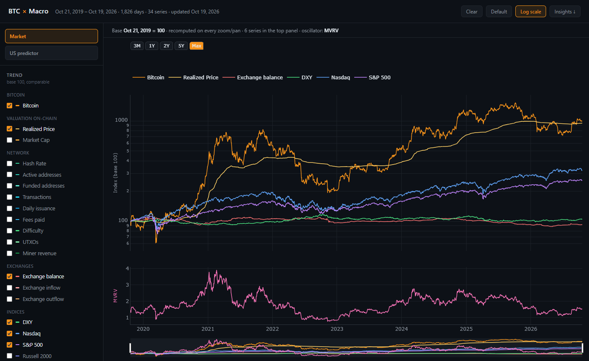
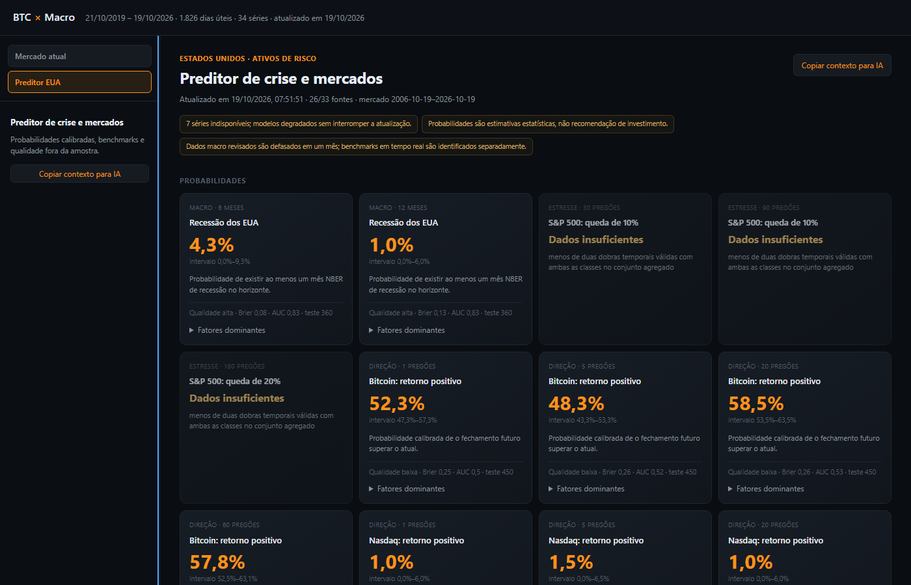

# btc-macro-dashboard

Dashboard that puts Bitcoin next to on-chain metrics, US indices, rates and commodities (34 daily series, 7 years), plus a calibrated predictor for US recession, S&P 500 drawdowns and short-term market direction.

Live: https://satscope.pages.dev (rebuilt every weekday after the US close).



- **Trend panel**: every series is rebased to 100 at the left edge of whatever window you're looking at, recomputed on each zoom/pan. Oscillators (MVRV, Fear & Greed, rates, VIX, net exchange flow) go in a second panel, in their own scale, one at a time.
- **Stats, in the browser**, no libraries: rolling Pearson/Spearman, lead/lag, beta/R², Engle-Granger cointegration (with the ADF pre-check that tells you when the test doesn't apply), conditional forward returns, z-score, percentile, realized vol, drawdown. Correlation and regression always run on returns, not prices.
- **Predictor**: logistic regression + gradient boosting, calibrated (isotonic, or Platt when one class is thin), repeated walk-forward with contiguous train/calibration/test blocks (no random splits), macro inputs lagged one month. Brier, log loss, AUC and calibration curves are all out of sample. A model with no edge falls back to the base rate and says so instead of printing a confident number.
- **Free data only**: CoinMetrics community API, Yahoo Finance, alternative.me, blockchain.info, FRED with fallbacks to BLS, BEA, Treasury, DOL, Chicago Fed and OFR when FRED doesn't answer.



## Run

```
pip install -r requirements.txt
python serve.py             # http://127.0.0.1:8765, a data snapshot is committed
```

Refresh the data:

```
python fetch_data.py        # ~1 min, web/data.json
python predictor.py         # a few minutes, web/predictor.json + predictor_history.csv
```

Tests: `python -m unittest test_predictor.py`

## Env

Both optional.

| var | |
|---|---|
| `BLS_API_KEY` | 20 years per BLS request instead of 10 |
| `BEA_API_KEY` | enables the BEA fallback (PCE, real GDP, income) |

## Notes

- Realized Price is derived, not downloaded: CoinMetrics took `CapRealUSD` off the free tier, but RP = price / MVRV and both of those are still free.
- `serve.py` binds to 127.0.0.1 only and sends a CSP that blocks anything external; plotly is vendored in `web/`.
- Macro data uses reference periods, not release-date vintages. The backtest lags it a month to compensate and says so in the payload.
- Market targets and features are built on each asset's own trading sessions. They used to live on BTC's 7-day calendar, where a Sunday row did `Monday / NaN > 1`, got a free "down" label, and the equity models learned to spot weekends: AUC 0.8 on next-day Nasdaq direction, and 1% on Monday mornings before the US open (no close yet, so it looked like a Sunday). With that gone, daily index direction is about a coin flip, which is the honest answer.
- Overlapping horizons are counted as what they are: 270 test days of a 60-session target are ~4 independent outcomes, so those cards stay "low" quality and close to the base rate.
- The Pages build refreshes the data on the runner and deploys it without committing, so the history doesn't fill up with bot commits. If a source is down that day, the committed snapshot goes up instead.
- Not investment advice.
